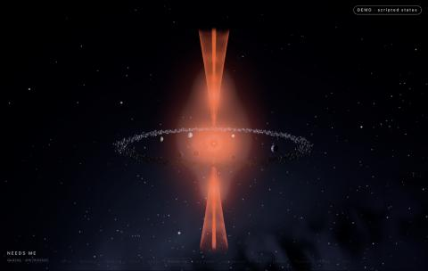

# Cosmos

**A live 3D galaxy of your Claude Code sessions.** Every session is a star system, every project is a spiral arm, and anything that needs your answer lights up as a neon-orange quasar you can spot from anywhere.



Cosmos runs entirely on your Mac. It reads the session files Claude Code already writes, so it costs **zero tokens** to run, and it never changes your sessions.

## What you see

| In the galaxy | What it means |
|---|---|
| Star system | One Claude Code session |
| Star in the center | The lead agent |
| White hole | A new session being born |
| Planets (with moons) | Folders the session worked in (moons are its most-touched files) |
| Ships flying star → planet | Tool calls: reading or editing files |
| Larger ships in their own orbit | Subagents |
| Spinning disk | How hard the session is working right now |
| Asteroid belt | Tokens spent (faint outer ring: reused cached context) |
| Star color, blue-white → red | How full the context window is |
| Neon-orange hourglass quasar | **Needs you now**: a permission prompt or a question |
| Calm ring | Your move: it finished and waits for your next message |
| Flare / flare storm | A failed tool call / several in a row |
| Black hole | A compaction (the conversation was summarized) |
| Grey haze, aging planets | Idle; after a day it settles into a still "dead" state |
| Dim remnant | Crashed or ended abnormally |
| Spiral arm | A project |

Press **?** inside Cosmos for the full legend.

## Features

- **Spot what waits on you:** needs-me sessions become quasars, get pinned to the top of the Needs me panel, and get edge-of-screen arrows when they're off view.
- **Status panels:** needs me, live sessions, activity feed, selected object, totals, and a galaxy minimap.
- **Navigation:** click to fly in, Esc to step back, breadcrumb, search (`/`), keyboard shortcuts.
- **Labels and hover popups** that explain every object in plain words, with its real numbers.
- **Event log and history replay:** scrub back through what happened.
- **Analysis & Diagnostic:** click an error to see what happened in plain English. **Show the error** reveals the real error text with the important parts explained. **Explain with Claude** gives a short lesson (this one button uses a few tokens and tells you how many).
- **Sound (optional):** real NASA space recordings as an ambient bed, and Sputnik's beep when a session needs you.
- **Settings panel**, including an optional "Open Cosmos?" prompt when you start a session.

## Run it

You need [Node.js](https://nodejs.org) 22 or newer (tested on 24) on macOS with Claude Code installed. There is nothing to install: no npm packages.

```sh
git clone https://github.com/TruSlide/cosmos.git
cd cosmos
node server.mjs
```

Then open **http://127.0.0.1:4747/web/galaxy.html**. The first start reads your whole session history once; after that it only reads what's new.

`/web/gate1.html` shows one star system cycling through every state, which is a good way to learn the objects.

## Privacy and safety

- The server listens on `127.0.0.1` only. Nothing is sent anywhere, except the text of one error when you click **Explain with Claude**.
- Cosmos never writes to `~/.claude`, with one exception you confirm yourself: the Settings panel can change two Claude Code settings (how long transcripts are kept, and the optional launch prompt). It shows the exact change first and backs up your settings file before writing.
- Its own cache lives in `cosmos/cache/` (session titles, file paths and numbers; never message text).

## Tests

```sh
node --test tests/*.test.mjs
```

Some tests read your own `~/.claude` data read-only, and skip when it isn't there.

## Credits

- 3D rendering: [three.js](https://threejs.org) r170 (MIT), included in `vendor/three/` with its license.
- Sounds: NASA recordings, see [web/sounds/CREDITS.md](web/sounds/CREDITS.md).
- Built with [Claude Code](https://claude.com/claude-code).

## License

MIT, see [LICENSE](LICENSE).
