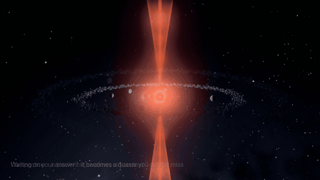

# Cosmos

**A live 3D galaxy of your Claude Code sessions.** Every session is a star system, every project is a spiral arm, anything that needs your answer lights up as an indigo quasar you can spot from anywhere, and a fresh crash flashes an orange distress beacon that outranks everything.



**[▶ Watch the 38-second demo (MP4)](media/cosmos-demo.mp4)** (recorded before the needs-me color moved from orange to indigo and the Tree of Knowledge arrived)

Cosmos runs entirely on your Mac. It reads the session files Claude Code already writes, so it costs **zero tokens** to run, and it never changes your sessions.

## What you see

| In the galaxy | What it means |
|---|---|
| Star system | One Claude Code session |
| Star in the center | The lead agent |
| White hole | A new session being born |
| Planets (with moons) | Folders the session worked in (moons are its most-touched files) |
| Ships flying star → planet | Tool calls: reading or editing files |
| Larger ships in their own orbit | Subagents |
| Spinning disk | How hard the session is working right now |
| Asteroid belt | Tokens spent (faint outer ring: reused cached context) |
| Star color, blue-white → red | How full the context window is |
| Indigo hourglass quasar | **Needs you now**: a permission prompt, a question or a plan to approve |
| Flashing orange distress beacon | **Crashed** in the last day: louder than needs-me until you dismiss it |
| Calm ring | Your move: it finished and waits for your next message |
| Flare / flare storm | A failed tool call / several in a row |
| Black hole | A compaction (the conversation was summarized) |
| Storms, cracks, then a world breaking apart | Idle: over its idle day the system dies (planets shatter, the star swells and collapses in a nova); dead systems replay it once a day |
| Oceans, green land, clouds, aurora | Archived or closed cleanly: a flourishing system |
| Dim remnant | An older crash |
| Faint lines between systems | Sessions that edited the same files (pulsing amber: two live sessions editing the same file, a possible overwrite) |
| The tree at the center | The Tree of Knowledge: branches above are live sessions, roots below are the rest, leaves are your saved knowledge |
| Distant galaxies, clusters, nebulae | The deep sky: more fills in as your lifetime tokens grow |
| Spiral arm | A project |

Press **?** inside Cosmos for the full legend.

## Features

- **Spot what waits on you:** needs-me sessions become quasars, crashes become distress beacons; both are pinned to the top of the Needs me panel and get edge-of-screen arrows when they're off view.
- **Mac notifications:** the server tells you about a crash right away, and about a session that has needed you for a minute, even when no Cosmos window is open (Settings > Notifications).
- **While you were away:** after a break, a card sums up what crashed, needs you, died, was born and was learned, with a 20-second camera tour.
- **Picture-in-picture:** a small window plays each dying system's death as a time-lapse (or shows flourishing ones).
- **Tree of Knowledge:** a pearlescent tree at the galactic center, grown from your sessions and your saved memories, skills and project rules; a gold beam lands in the canopy when a session saves something new. "You" orbit it, with threads to everything waiting on you.
- **Spend lens (`$`):** color every system by tokens spent today.
- **Open in Claude:** jump from a session in Cosmos to that session in the Claude desktop app.
- **Status panels:** needs me, live sessions, activity feed, selected object, totals, and a galaxy minimap.
- **Navigation:** click to fly in, Esc to step back, breadcrumb, search (`/`), keyboard shortcuts.
- **Hover names and a Selected panel** that explains every object in plain words, with its real numbers.
- **Event log and history replay:** scrub back through what happened.
- **Analysis & Diagnostic:** click an error to see what happened in plain English. **Show the error** reveals the real error text with the important parts explained. **Explain with Claude** gives a short lesson (this one button uses a few tokens and tells you how many).
- **Sound (optional):** real NASA space recordings as an ambient bed, and Sputnik's beep when a session needs you.
- **Settings panel** for everything above.
- **Record button:** capture the 3D view as a video to share. It records only the universe, never panels or labels, so session names stay private. Clips save to `cosmos/recordings/`.

## Run it

You need [Node.js](https://nodejs.org) 22 or newer (tested on 24) on macOS with Claude Code installed. There is nothing to install: no npm packages.

```sh
git clone https://github.com/TruSlide/cosmos.git
cd cosmos
node server.mjs
```

Then open **http://127.0.0.1:4747/web/galaxy.html**. The first start reads your whole session history once; after that it only reads what's new.

`/web/gate1.html` shows one star system cycling through every state, which is a good way to learn the objects.

## Privacy and safety

- The server listens on `127.0.0.1` only. Nothing is sent anywhere, except the text of one error when you click **Explain with Claude**.
- Cosmos never writes to `~/.claude`, with one exception you confirm yourself: the Settings panel can change how long Claude Code keeps transcripts. It shows the exact change first and backs up your settings file before writing.
- It also reads, never writes: your memories and skills under `~/.claude` (names and one-line descriptions only) for the Tree of Knowledge, and optionally a Parking Lot script (`COSMOS_PENDING_SCRIPT`) for the Needs me panel.
- Mac notifications use `osascript` to show a banner; nothing else is run.
- Its own cache lives in `cosmos/cache/` (session titles, file paths and numbers; never message text).

## Tests

```sh
node --test tests/*.test.mjs
```

Some tests read your own `~/.claude` data read-only, and skip when it isn't there.

## Credits

- 3D rendering: [three.js](https://threejs.org) r170 (MIT), included in `vendor/three/` with its license.
- Sounds: NASA recordings, see [web/sounds/CREDITS.md](web/sounds/CREDITS.md).
- Built with [Claude Code](https://claude.com/claude-code).

## License

MIT, see [LICENSE](LICENSE).
